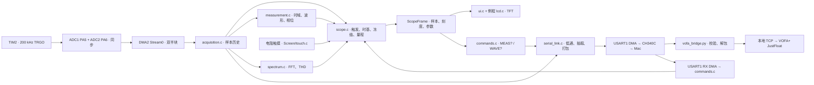

# KF56-10 示波器代码架构

固件运行在 STM32F407ZGT6。CubeMX 管外设，应用代码按采集、测量、触发、串口和显示划分。触摸和指令修改同一份示波器配置，测量查询与 LCD 读取同一份已发布捕获。

| 文件 | 职责 |
|---|---|
| `Third_Task.ioc`、`Core/` | HSE、时钟树、FSMC、TIM2、ADC1/2、UART、DMA 和中断初始化 |
| `App/app.c/.h` | 启动应用，每轮先消费采样，再服务串口、算法、触摸和部分绘屏 |
| `App/acquisition.c/.h` | ADC DMA 半块、历史环、丢块统计 |
| `App/scope.c/.h` | 软件触发、共享配置、帧保持、时基、自动量程 |
| `App/measurement.c/.h` | 峰峰值、平均电压、频率、波形分类和相位 |
| `App/spectrum.c/.h` | 4096 点 FFT、五次谐波、THD |
| `App/stream_encode.c/.h` | 按每包、每路的电压范围压缩实时样点 |
| `App/serial_link.c/.h` | RX DMA、命令收行、TX DMA、连续串流和波形快照 |
| `App/commands.c/.h` | 命令参数校验、配置更新、结果回读 |
| `App/ui.c/.h` | 网格、垂直和时间刻度、触摸按钮、游标、谐波柱图 |
| `Screen/` | 培训例程的 `lcd.c/lcd.h/FONT.H` 和第二题的触摸、EEPROM 驱动 |
| `tools/` | VOFA+ 桥接、主机算法回归和实板串口测试 |

## 各功能怎么工作

| 功能 | 最直白的解释 | 代码入口 |
|---|---|---|
| ADC 采集 | 定时器每隔 5 µs 叫 ADC 量一次电压。ADC 把电压变成 0–4095 的数字，DMA 攒够一半缓冲再通知程序取走。另一半缓冲接着存下一批。 | `Acquisition_Start`、`Acquisition_Poll` |
| Mac 波形 | 板子把样点打包，经 CH340C 从串口转成 USB。Mac 上的桥接还原样点和值，转成 VOFA+ 会画的 JustFloat 格式。 | `Serial_StreamBlock`、`vofa_bridge.py` |
| 串口指令 | 收到换行才解析整条命令。参数检查通过才改设置，否则只回 `ERR`。`WAVE?` 取当前捕获帧，连续串流则一直取最新样点。 | `Serial_Poll`、`Commands_Execute` |
| 频率、峰峰值和直流 | 两次同方向穿过中间电压之间，就是一个周期。频率是周期的倒数。峰峰值是最高减最低。直流是完整周期里的平均电压。 | `find_extrema`、`count_edges` |
| 波形识别 | 看信号在最高和最低电压附近待了多久。方波在两端停得久，三角波一直斜着走，正弦波在峰顶和谷底附近走得慢一些。 | `count_edges` |
| 触发对齐 | 找到电压越过设定线的那个时刻，把每帧的这个位置都画在同一列。用 `RISE` 找从下往上的穿越，用 `FALL` 找从上往下的穿越。 | `Scope_Consume`、`Scope_Poll` |
| 三种触发模式 | 自动档找不到触发时，等一会儿也画最新样点。正常档继续显示上一帧，找到下一次触发才更新。单次档抓到一帧就停，重新武装后才再抓。 | `Scope_SetMode`、`Scope_Poll`、`poll_single` |
| TFT 实时显示 | 每列像素用对应时间段的最高、最低点画一小段，窄峰也能保留。屏幕扫过一块区域后才写入这块区域的新像素，减少新旧帧混在一起。 | `prepare_trace`、`stripe_is_safe`、`paint_stripe` |
| 时基和垂直档位 | 时间每格越长，整屏容纳的采样时间越长。每格电压越大，同样 1 V 在屏幕上占的格子越少。两项都按刻度重新计算坐标。 | `Scope_SetTime`、`Scope_SetVertical`、`voltage_to_row` |
| 冻结和双游标 | 停止时留住当前画面和对应读数。两条游标的横向距离按时基换成时间差。如果两条线卡在相邻周期的同一个位置，`1/dT` 就是频率。 | `Scope_Stop`、`scan_touch`、`paint_readout` |
| 双通道 | 同一个定时器事件让两个 ADC 同时量电压，DMA 把这一对数字一起搬走。两路用同一时间轴和不同颜色画出。 | `Acquisition_Start`、`Acquisition_Code`、`paint_stripe` |
| 相位差 | 把两路波形放到同一个基波参考上量角度。CH2 比 CH1 先到同一位置时记为超前，最终把角度换到 0°–360°。 | `prepare_phase`、`measure_phase` |
| FFT、谐波和 THD | FFT 看波形里有哪些频率。找到基波和它的 2 到 5 倍频率，画出各自的幅值。THD 是这四项谐波的合成幅值除以基波幅值。 | `Spectrum_Poll`、`calculate_harmonics`、`prepare_bars` |
| 自动量程 | 先算波形占屏幕多高。连续几次偏离目标范围才改每格电压，让波形回到约 70% 高度，减少来回换挡。 | `update_range` |

## 采样与并发

- 系统时钟 168 MHz，APB1 为 42 MHz，TIM2 为 84 MHz。PSC 为 0，ARR 为 419，每 5 µs 产生一次 TRGO。
- ADC 时钟 21 MHz，56 个采样周期加 12 个转换周期。ADC1/2 规则同时采样，DMA 以 32 位从 CDR 搬运，一字分别保存 CH1 和 CH2。
- ADC DMA 每半块 1024 对样本，约 5.12 ms。中断递增块号，前台复制已结束半块，校验期间是否有新的半块到达。延误覆盖计入 `DMADROP`。
- 发布捕获时将每对双路 12 位样点无损存为 3 字节，`Scope_FrameCode()` 按通道取回原始码。绘图按列用整数寻找原始码的上下极值，再与插值端点合并。
- DMA 缓冲和 UART 包位于 SRAM，16,384 对的历史环放在 CPU 可访问的 CCM。算法分批推进，LCD 每次写 8 行。UART 在发送完成中断启动下一包，减少绘屏时隙造成的发送间隔。
- 命令成批到达时，接收 DMA 先缓存字节。前台等发送队列留够下一批样点和恢复包的槽位，再解析下一条命令。`WAVE?` 预留两个槽，分别装快照和应答。
- ILI9341 的 `0x45` 返回实时扫描行。绘图区用同一份捕获合成条带，每次等屏幕扫过对应位置，再用例程的 `LCD_Color_Fill` 写入这 8 行像素。驱动将可见扫描之间的垂直前肩设为 64 行，应用仍按约 20 FPS 提交新图。`STAT?` 可查看同步状态和错过写屏窗口的计数。[ILI9341 数据手册，第 140、162 页](https://robu-prod-media.s3.ap-south-1.amazonaws.com/uploads/2018/02/ILI9341_v1.11.pdf#page=140)
- 软件触发检查真实样本穿越并插值，把触发固定在全屏四分之一。正常档等到触发才发布，单次模式保留第一次有效触发，用触发后的 8192 点完成测量后冻结并发布一帧。Auto 找不到触发时按超时取最新窗口。
- 时域测量用约 41 ms 的原始数据。频率由同向穿越的间隔得出，类型用靠近上下峰值的停留比例，直流取完整周期平均。相位用两路共同的基波参考，FFT 用 Hann 窗和频谱峰插值估算 CH1 的 1 到 5 次谐波。

## 串口协议

板载 USART1 为 1,200,000 baud、8N1。接收 ASCII 命令以 CR 或 LF 结尾。发送包以 `A5 5A` 开头，后接消息类型、标志字节、两字节负载长度、四字节序号、负载和 CRC16-CCITT（初值 FFFF，范围从类型到负载末字节）。捕获包的参考电压来自该帧的采集配置，便于复算冻结样点。整数为小端。串流和恢复包的标志字节最低位为路数减一，上七位分别存组内序号和恢复组号。捕获包的低两位保存路数。

| 类型 | 负载 |
|---|---|
| 1 实时串流 | 单路 100 kS/s，双路每路 50 kS/s。每包 256 个时刻。包头为每路的 12 位最小值和跨度，各占 2 字节，后面是按该跨度量化的 8 位相对码。双路按同一时刻交错。序号为包首样本的输出序号。 |
| 2 应答 | `OK`、`ERR` 或 ASCII 查询结果。 |
| 3 捕获 | 总时跨度、点数、参考电压、触发标志，以及 240 个均匀时刻的 12 位样本。两个码装入三字节，序号为捕获编号。 |
| 4、5 恢复包 | 每 126 个串流包依次交错分入六组，每组各发一个逐字节异或和一个 GF(256) 带权异或恢复包。恢复包序号为这 126 包的首个样本。Mac 校验 CRC 后按序转发，每组最多恢复两个缺包。恢复包完整时可补回连续 12 个数据包，合计开销约 9.5%。 |

实时串流先在固件低通再抽取。每包量化的最大误差为该包跨度的 1/510。板上测量、TFT 和 `WAVE?` 使用 12 位数据。桥接在 Mac 上校验包并换成 VOFA+ 自带的 JustFloat。应答使用同一帧尾，文本长度避开 4 的倍数，使 VOFA+ 将其留在字节接收区。接收侧按原样转发 TCP 字节，固件统一处理超长输入和缺少换行的命令。单路曲线默认补半步插值以便观看 20 kHz 附近的波形，原始采样时刻仍保留，实收采样率依然是 100 kS/s。 [VOFA+ JustFloat 协议](https://www.vofa.plus/docs/learning/dataengines/justfloat/)

## 常改项

| 要改什么 | 文件 |
|---|---|
| ADC 采样率 | `Third_Task.ioc` 的 TIM2 Period 和 `App/scope_config.h` 的 `SCOPE_SAMPLE_HZ`，两处同步。启动时核对。 |
| 时基和手动增益档位 | `App/scope.c` 的 `time_divs` 和 `volt_divs`。新增更慢时基时同步检查最大捕获长度和内存。 |
| 默认触发阈值、边沿、模式 | `Scope_Init()` |
| PHASE 正负约定 | `App/measurement.c`，CH2 相对 CH1 超前为正，输出 0°–360° |
| 串口波特率 | `Third_Task.ioc` 的 USART1 与 `tools/vofa_bridge.py --baud` |
| 名义 ADC 参考电压 | `App/scope_config.h`，也可用 `VREF 3.27` 设置实测值 |

现场练习改采样率时，可以用 160 kHz 做一遍。TIM2 的输入时钟是 84 MHz，预分频器为 0，把 `Period` 从 419 改成 524，再将 `SCOPE_SAMPLE_HZ` 改成 `160000`。CubeMX 生成后编译并用 `STAT?` 核对 `FS=160000`。此时 VOFA+ 单路默认横轴每点是 6.25 µs，单路 `--raw-points` 是 12.5 µs，双路是 25 µs。正式演示的配置是 200 kHz。

CubeMX 重新生成时保留用户代码区，应用入口在 `Core/Src/main.c` 的 `USER CODE` 内。检查根 CMake 仍包含 `App` 和 `Screen`，并确认链接脚本的 4 KB 堆栈和只供 CPU 使用的 CCM 段配置。
